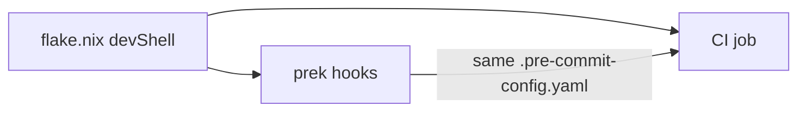

# Project bootstrap

Target state: one command gives a reproducible toolchain, and every check runs identically on commit, push and CI.

## 1. Dev environment

- `nix flake init -t ~/projects/think-nix#devshell` (provides `flake.nix`, `.envrc`, `.gitignore`, `.pre-commit-config.yaml`)
- Add the runtime/toolchain to `packages`, pinning majors to the deploy target (`nodejs_24` + `pnpm`, `python313` + `uv`, …)
- `git add -A && direnv allow`. The devShell installs the prek hook on first load
- Commit `flake.lock`; for app dependencies use the ecosystem lockfile (`pnpm-lock.yaml`, `uv.lock`)
- Use the `nixos-unstable` input. Pin runtime **majors** to the deploy target (`nodejs_24`, `python313`, `jdk21`), not generic `nodejs`/`python3`.
- **Node:** `pnpm` from the flake. **Python:** `uv` (`uv init/add/run`) with the flake's interpreter: set `UV_PYTHON_DOWNLOADS=never` in `shellHook`.
- **Services** (Postgres, Redis…): start in the devShell with data under a gitignored project dir (see `~/projects/zozahrady/flake.nix`), or use `podman-compose`.
- Handy ephemeral extras (`nix shell nixpkgs#…`): `ast-grep`, `difftastic`, `hyperfine`, `tokei`, `sd`, `watchexec`, `shfmt`, `actionlint`, `typos`.

## 2. Hooks (`.pre-commit-config.yaml`, run by `prek`)

Hooks run `language: system` with tools from the devShell, so nothing is fetched and versions are pinned.
Keep pre-commit **fast** (staged files only, a few seconds). Put slower suites in `pre-push` or CI.

| Stage | Always | Per stack (examples) |
|---|---|---|
| pre-commit | builtin hygiene, `detect-private-key`, **gitleaks**, formatter | prettier/eslint, ruff + ruff-format, nixfmt, shellcheck, `tsc --noEmit` / mypy (if fast) |
| pre-push | unit tests | `pnpm test:unit`, `uv run pytest -q` |
| CI | `prek run --all-files`, full tests, build | integration/e2e, migrations check, `gitleaks git` over full history |

Existing projects that already use husky/lint-staged (e.g. Node repos) can keep them. Add gitleaks there instead of replacing them.

## 3. CI (same checks, no drift)

- **Forgejo** (homelab primary, `.forgejo/workflows/ci.yml`) or **GitHub Actions** (`.github/workflows/ci.yml`). Same YAML syntax.
- Prefer running checks through the flake, e.g. `nix develop -c prek run --all-files`, so CI uses exactly the local tools.
  Use a `nixos/nix` container or `cachix/install-nix-action`. If the stack's native setup actions are much faster
  (e.g. pnpm cache), use them, but run the **same scripts** (`pnpm check`).
- Make CI a required status check, and protect `main`.
- Copy the reference: `~/projects/think-nix/.forgejo/workflows/ci.yml`.

## 4. Secrets

- Never in git, in any repo, public or private. Only `.env.example` (placeholders) is committed. `.env*` is gitignored.
- Runtime secrets come from `pass`, the platform's secret store (Forgejo/GitHub secrets, Vercel env), or a gitignored file
  referenced by config (Kilo `{ file:… }`, `{ env:… }` without spaces).
- If a secret was ever committed: treat it as leaked. Rotate it first, then rewrite history if needed.

## 5. MCP servers for the project

Global MCPs (context7, nixos) are already configured. Add only project-specific ones (database, hosting, design, …)
to the project config: `kilo.jsonc` / `opencode.json` / `.mcp.json`. Use OAuth or `{ env:… }` / `{ file:… }` references,
never inline tokens. Document them in AGENTS.md.

## 6. Agent and docs layout

- `AGENTS.md`: stack, commands (dev/test/check/build), auto-triggered checks (don't re-run), conventions, danger zones.
  Keep it short and link to deeper docs. Add `CLAUDE.md` containing `See AGENTS.md` if Claude Code is used.
- `docs/product/` (vision, personas), `docs/specs/` (per-feature specs), `docs/architecture/`, `docs/adr/`, `docs/runbook.md`.
  This matches `~/projects/project-seed`. Prefer instantiating that template (copier) for homelab projects.

## 7. Hosting

Homelab repos: Forgejo `homelab/<repo>` is `origin`, with a GitHub push-mirror as backup. Register the repo in
`~/projects/homelab/repos.yml`. See `~/projects/raspi5-lab/docs/runbook.md` ("Forgejo push mirrors").
