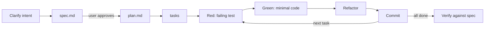

# Spec-Driven Development + TDD

Goal: intent is written down and agreed **before** code; every behavior is pinned by a test **before** it is implemented.
Scale the ceremony to the change: a one-line fix needs a failing test, not a spec document.

## Flow

## 1. Spec (what & why, no how)

Location: `docs/specs/<NNN>-<slug>/spec.md` (or the repo's existing convention).

- Problem, users/personas, goals and **non-goals**
- User stories with **acceptance criteria** in Given/When/Then; each criterion must be testable
- Constraints (performance, security, compliance, compatibility), assumptions, open questions
- Mark every guess as `[NEEDS CLARIFICATION: …]`; never silently invent requirements

Ask the user to review the spec. Do not plan or code on an unapproved spec.

## 2. Plan (how)

`plan.md` next to the spec:

- Architecture sketch (mermaid), components and their single responsibility, data model, interfaces/contracts
- Options for each significant decision → load the `decision-brainstorm` skill; record the chosen one as an ADR
  (`docs/adr/NNNN-<title>.md`: context, decision, consequences)
- Test strategy: which levels (unit / integration / e2e / contract) cover which acceptance criteria
- Risks and rollout (migrations, feature flags, backwards compatibility)
- Check against the project's `CONSTITUTION.md` / AGENTS.md principles, if present

## 3. Tasks

Ordered, small (≤ ~1h each), each independently testable and committable. Tests-first tasks precede their implementation.
Trace each task to the acceptance criterion it satisfies.

## 4. Red → Green → Refactor (per task)

1. **Red:** write the smallest test expressing the next behavior; run it; confirm it fails **for the right reason**.
2. **Green:** the simplest code that passes. No speculative generality (YAGNI).
3. **Refactor:** remove duplication, improve names/structure with tests green. Behavior must not change.
4. Run the full relevant suite + project hooks, then **commit** (Conventional Commits; test and code together).

Rules: never weaken or delete a test to make it pass; never mock what you own when an in-memory fake is simpler;
test behavior through public interfaces, not implementation details; one assertion concept per test.

## 5. Verify & close

- Walk every acceptance criterion and point at the test that proves it
- Update docs (README, architecture, runbook) and the spec's status
- Summarize to the user: what was built, deviations from spec (with reasons), follow-ups
